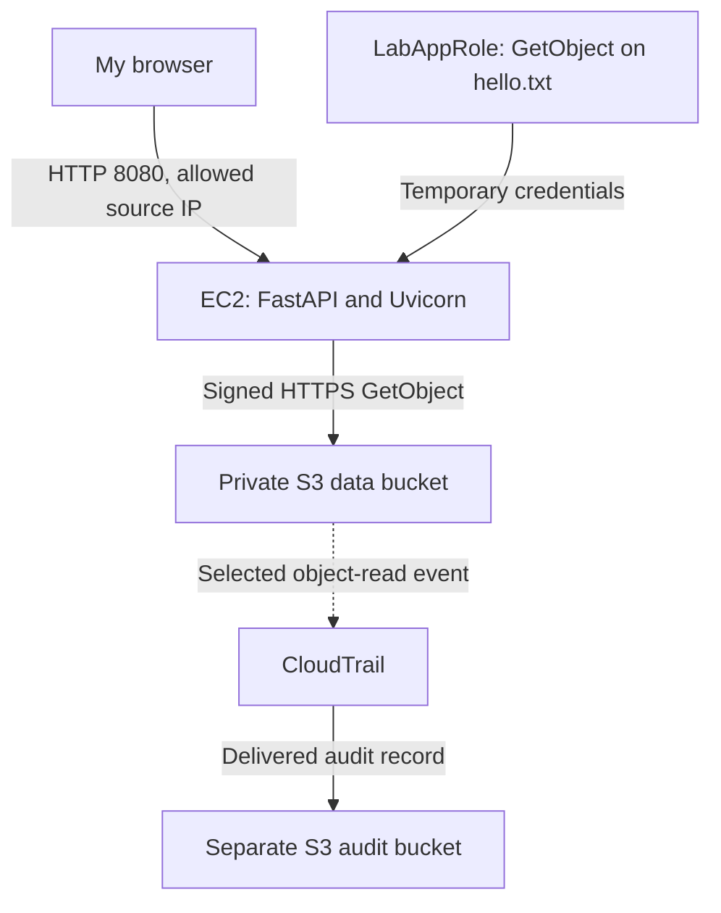

# AWS EC2 and Private S3 Security Lab

I built a small Python API on EC2 that reads one text file from a private S3 bucket. My goal was to understand how application behavior, IAM permissions, network restrictions, and audit records fit together.

The useful part was not just getting a successful response. I also checked that the application role could not list the bucket, tested access from a different connection, and captured the successful object read in CloudTrail.

**[Read my detailed lab report (PDF)](docs/AWS_EC2_S3_Security_Lab_Public.pdf)**  
**[Read the report on GitHub (Markdown)](docs/lab-guide.md)**

## Architecture



The browser-to-API connection used HTTP in this controlled lab. The recorded API-to-S3 request used TLS 1.3. The private S3 bucket was not made public to make the API work.

## What I did

1. Set up a separate lab account and a named IAM Identity Center user.
2. Separated builder access from temporary role-setup and audit-setup access.
3. Created `LabAppRole` with permission to read only `hello.txt`.
4. Created a private S3 bucket with Block Public Access enabled, ACLs disabled, and SSE-S3 encryption.
5. Launched an Amazon Linux EC2 instance with an encrypted root volume and IMDSv2 required.
6. Restricted SSH and the API port to my then-current public IP address.
7. Built and tested `/health` and `/hello` with FastAPI, Uvicorn, and Boto3.
8. Investigated SSH key permissions, a missing Python environment, and an occupied port.
9. Reviewed CloudTrail management events and configured a narrowly scoped S3 data-event trail.
10. Downloaded the evidence and application source, then removed the temporary lab resources.

## Results

| Test | Observed result | What I learned |
| --- | --- | --- |
| `GET /health` | HTTP 200 and `{"status":"ok"}` | The application was answering requests. |
| `GET /hello` | HTTP 200 and the text from `hello.txt` | The application could complete its S3 retrieval. |
| Instance role reading the exact object | Succeeded | The intended object-read permission worked. |
| Same role listing the bucket | `AccessDenied` for `s3:ListBucket` | Reading one object did not require listing the bucket. |
| Unsigned direct S3 URL | `AccessDenied` | That unauthenticated request could not read the private object. |
| Alternate-connection API test | Timed out while the allowed connection still worked | Consistent with the source-IP restriction; a timeout alone would not prove the cause. |
| S3 CloudTrail data event | `GetObject`, role `LabAppRole`, HTTP 200, 34 bytes | The audit record connected the read to the application role. |

The successful instance launch was distinct from three earlier `DryRunOperation` records. Those earlier events were checks, not additional running instances.

## Repository contents

- `app.py`: my saved application source, with its bucket name replaced by an example value.
- `requirements.txt`: direct dependency versions recorded during the lab installation, not a full transitive lockfile.
- `policies/`: sanitized role-policy examples, a PassRole statement, and the data-event selector.
- `evidence/`: clearly labeled, sanitized excerpts of the recorded events and a test summary.
- `docs/`: my public report as PDF and Markdown.
- `.gitignore`: excludes common credential files, local environments, and raw private evidence directories.

## Running a separate copy

This repository is a record of a completed lab. The original infrastructure has been removed. It is not an automated deployment package.

For a new exercise, create your own private S3 bucket and upload `hello.txt`. Change the `BUCKET` value in `app.py` and the object ARN in the permissions policy to match your bucket. Attach the role through an EC2 instance profile with the matching trust policy. The example names are placeholders, not working resources.

On the new EC2 instance, with Python 3.11 available:

```bash
python3.11 -m venv .venv
source .venv/bin/activate
python -m pip install -r requirements.txt
python -m uvicorn app:app --host 127.0.0.1 --port 8080
```

From a second shell on that instance:

```bash
curl -i http://127.0.0.1:8080/health
curl -i http://127.0.0.1:8080/hello
```

Boto3 creates its S3 client when the module loads. Run this in an environment with the intended AWS role credentials available. I did not store permanent AWS keys in the application. For the original remote test, I bound Uvicorn to `0.0.0.0` and separately allowed TCP 8080 only from my source IP in the security group.

The dependency versions above are historical versions from the lab, not a claim that they are the latest or a security-reviewed production dependency set. The public packaging check validated Python syntax, the unchanged application logic, JSON structure, and sanitization. It did not redeploy the deleted environment or repeat the AWS integration tests.

## Limits and lessons

This was a guided learning exercise, completed with AI-assisted guidance. I carried out the setup and tests and checked the results in the console, terminal, and logs.

I did not add HTTPS to the API, application authentication, a service supervisor, high availability, infrastructure as code, or automated deployment. The builder permission set was broader than the application's tightly scoped role. The CloudTrail selector covered reads of one object, not every account action.

My next iteration would add reproducible infrastructure, HTTPS, an explicit application access policy, and repeatable positive and negative tests.

## Cleanup

I terminated the instance, checked the remaining volumes, removed the lab security group and key pair, deleted the data and audit buckets, deleted the trail and application role, and removed the temporary setup assignments. I kept the account foundations and retained LabBuilder for final checks. This describes the cleanup I recorded, not a fresh audit of all resources in the account.

## Public-data handling

All account IDs, IP addresses, bucket names, instance IDs, and session identifiers shown here are examples or sanitized values. The JSON files are edited excerpts, not original audit exports or independently verifiable signed evidence.

I excluded the original screenshots, unredacted logs, private keys, AWS credentials, session tokens, personal email addresses, and billing information. The public report uses text explanations and selected event fields so the original image data cannot expose account context. My name is retained as the author.

See [the evidence notes](evidence/README.md) and [the policy notes](policies/README.md) for scope and provenance.
